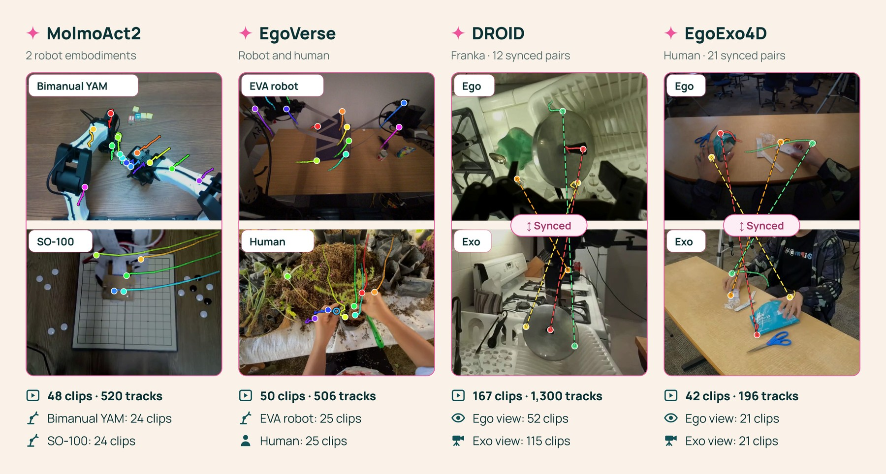
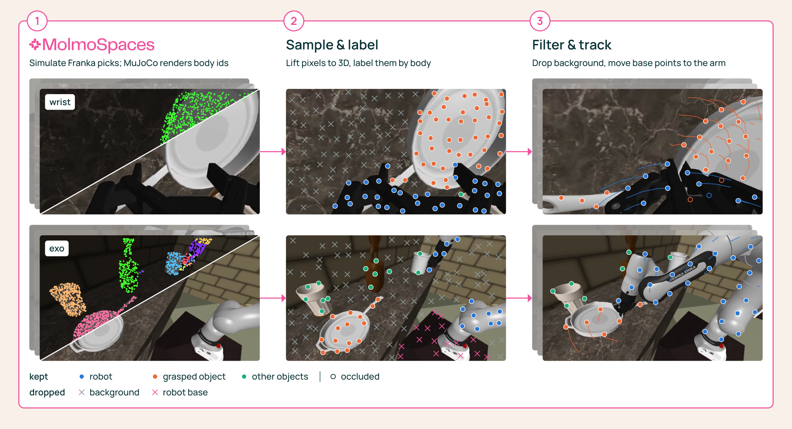

<div align="center">
  
  <h1>RoboTrack: Point Tracking for Real-World Robotic Manipulation</h1>
</div>

<p align="center">
  <a href="#7-license">
    
  </a>
  <a href="https://robotrack.allen.ai">
    
  </a>
  <a href="https://allenai.org/blog/robotrack">
    
  </a>
  <!-- TODO: arXiv badge  <a href="https://arxiv.org/abs/ARXIV_ID"></a> -->
  <a href="https://huggingface.co/allenai/RoboTracker">
    
  </a>
  <a href="https://huggingface.co/allenai/RoboTracker-Warp">
    
  </a>
  <a href="https://huggingface.co/datasets/allenai/RoboTrack-Bench">
    
  </a>
  <a href="https://huggingface.co/datasets/allenai/RoboTrack-15M">
    
  </a>
</p>

<p align="center">
  <a href="https://vincentshao32.github.io/">Vincent Shao</a><sup>1,2</sup>, <a href="https://maxargus.com/">Max Argus</a><sup>1</sup>, <a href="https://www.winsonhan.com/">Winson Han</a><sup>1</sup>, <a href="https://www.elivanderbilt.com/">Eli VanderBilt</a><sup>1</sup>, <a href="https://www.linkedin.com/in/carissaschoenick/">Carissa Schoenick</a><sup>1</sup>, <a href="https://homes.cs.washington.edu/~ali/">Ali Farhadi</a><sup>2</sup>, <a href="https://www.ranjaykrishna.com/index.html">Ranjay Krishna</a><sup>2</sup>, <a href="https://jason718.github.io/">Zhongzheng Ren</a><sup>1,3</sup>, <a href="https://jaesungpark96.github.io/">Jae Sung Park</a><sup>1</sup>
</p>

<p align="center">
  <sup>1</sup>Allen Institute for AI &nbsp;&nbsp; <sup>2</sup>University of Washington &nbsp;&nbsp; <sup>3</sup>University of North Carolina at Chapel Hill
</p>

<p align="center"><sub>Apache 2.0, except <code>robotrack/cowtracker/</code> (non-commercial). RoboTracker-Warp weights are CC-BY-NC 4.0. <a href="#7-license">Details</a>.</sub></p>

[RoboTrack](https://robotrack.allen.ai) is Ai2's training and benchmarking data suite for point tracking on real robot video. **[RoboTrack-Bench](https://huggingface.co/datasets/allenai/RoboTrack-Bench)** is a benchmark of real robot and
human manipulation clips with hand-annotated point tracks. **[RoboTrack-15M](https://huggingface.co/datasets/allenai/RoboTrack-15M)** is simulated robot training data built with
[MolmoSpaces](https://github.com/allenai/molmospaces). **[RoboTracker](https://huggingface.co/allenai/RoboTracker)**, [AllTracker](https://github.com/aharley/alltracker) fine-tuned on that data, improves on AllTracker on RoboTrack-Bench and on
standard tracking benchmarks. **[RoboTracker-Warp](https://huggingface.co/allenai/RoboTracker-Warp)** is a state-of-the-art tracking model based on [CoWTracker](https://github.com/facebookresearch/cowtracker). 

---
### Updates
- **[2026/11/23]** 🔥 RoboTrack is released: the benchmark, the training data, RoboTracker, RoboTracker-Warp, and code to evaluate and train them.

## 1. Models

| Model | Use Case | Description | Checkpoint Path |
| --- | --- | --- | --- |
| RoboTracker | Inference / Fine-tuning | AllTracker fine-tuned for 10k steps on 50% Kubric + 50% [RoboTrack-15M](https://huggingface.co/datasets/allenai/RoboTrack-15M), starting from the released `alltracker.pth`. Same architecture and file format as AllTracker. Apache 2.0. | https://huggingface.co/allenai/RoboTracker |
| RoboTracker-Warp | Inference / Fine-tuning | CoWTracker fine-tuned the same way (10k steps, 50% Kubric + 50% RoboTrack-15M) from the released CoWTracker. Our most accurate tracker; about 1B parameters and slower. **Non-commercial** (CC-BY-NC 4.0). | https://huggingface.co/allenai/RoboTracker-Warp |

## 2. Datasets

| Data | Use Case | Description | Dataset Path |
| --- | --- | --- | --- |
| RoboTrack-Bench | Evaluation | 307 real robot and human manipulation clips with 2,522 hand-annotated point tracks. | https://huggingface.co/datasets/allenai/RoboTrack-Bench |
| RoboTrack-15M | Training | 3,000 simulated videos of a Franka arm picking objects in 300 ProcTHOR houses, from wrist and third-person cameras, with 15 million point tracks on the robot and moving objects. 17 GB. | https://huggingface.co/datasets/allenai/RoboTrack-15M |

## 3. Installation

```bash
git clone https://github.com/allenai/robotrack.git
cd robotrack
pip install -e .        # install PyTorch for your CUDA version first
```

## 4. Evaluation on RoboTrack-Bench

<p align="center">
  
</p>

**RoboTrack-Bench at a glance:** examples from each source dataset. MolmoAct2 and EgoVerse show one embodiment per panel;
DROID and Ego-Exo4D show synchronized ego (top) and exo (bottom) views.

```bash
python -m robotrack.eval_alltracker --checkpoint robotracker \
    --data-root data/RoboTrack-Bench --download --out results/robotracker.json
```

- **What it writes:** the mean and per-clip scores, as `results/robotracker.json`.
- **`--checkpoint`:** `robotracker`, `robotracker-warp`, a URL, or a local `.pth` holding
  `{"model": state_dict}`.
- **`--save-predictions DIR`:** also writes each clip's predicted tracks, in video pixels.
- **`--download`:** fetches the benchmark the first time; drop it afterwards.
- **Run time:** about 20 minutes on one H200.

Scores on RoboTrack-Bench. Every model was evaluated by us with the protocol below. The best score in each column is bold and the second best is underlined. Under training data, 15k and 15M are real videos pseudo-labelled by CoTracker3 and BootsTAPNext, and mix is AllTracker's second-stage mix of point-tracking and optical-flow datasets.

| Model | Training data | AJ | <δavg | OA |
|---|---|---|---|---|
| CoTracker3 (offline) | Kubric | 59.77 | 73.23 | 84.63 |
| CoTracker3 (offline) | Kubric+15k | 60.25 | 72.58 | 85.84 |
| CoTracker3 (online) | Kubric+15k | 61.82 | 74.90 | 87.31 |
| TAPNext | Kubric | 55.06 | 69.74 | 87.17 |
| BootsTAPNext | Kubric+15M | 60.15 | 73.51 | 87.15 |
| AllTracker | Kubric | 61.37 | 74.48 | 83.88 |
| AllTracker | Kubric+mix | 62.56 | 75.69 | 86.87 |
| CoWTracker | Kubric | <u>63.87</u> | <u>76.12</u> | <u>88.49</u> |
| **RoboTracker** | Kubric+mix+RoboTrack-15M | 63.40 | <u>76.12</u> | 86.22 |
| **RoboTracker-Warp** | Kubric+RoboTrack-15M | **65.98** | **77.93** | **89.00** |

AJ by video source. Each score is the mean over that source's clips.

| Model | Training data | DROID Franka<br>(167 clips) | MolmoAct2 YAM<br>(24 clips) | MolmoAct2 SO-100<br>(24 clips) | EgoVerse EVA<br>(25 clips) | EgoVerse human<br>(25 clips) | Ego-Exo4D human<br>(42 clips) | All<br>(307 clips) |
|---|---|---|---|---|---|---|---|---|
| CoTracker3 (offline) | Kubric | 60.00 | 68.32 | 58.09 | 61.78 | 58.28 | 54.67 | 59.77 |
| CoTracker3 (offline) | Kubric+15k | 60.15 | 66.76 | 57.82 | 63.07 | 60.95 | 56.23 | 60.25 |
| CoTracker3 (online) | Kubric+15k | 61.76 | 68.30 | 59.15 | 64.49 | 62.66 | 57.77 | 61.82 |
| TAPNext | Kubric | 56.63 | 59.10 | 53.90 | 55.14 | 47.97 | 51.34 | 55.06 |
| BootsTAPNext | Kubric+15M | 62.32 | 64.00 | 59.03 | 59.36 | 50.94 | 55.96 | 60.15 |
| AllTracker | Kubric | 60.19 | 68.66 | 61.10 | 66.71 | <u>62.78</u> | 58.06 | 61.37 |
| AllTracker | Kubric+mix | 61.97 | 68.88 | 61.41 | 66.21 | **62.87** | 59.60 | 62.56 |
| CoWTracker | Kubric | <u>64.42</u> | 69.22 | <u>63.22</u> | 66.43 | 60.95 | 59.20 | <u>63.87</u> |
| **RoboTracker** | Kubric+mix+RoboTrack-15M | 63.16 | <u>69.75</u> | 61.20 | <u>67.39</u> | 62.37 | <u>60.26</u> | 63.40 |
| **RoboTracker-Warp** | Kubric+RoboTrack-15M | **66.82** | **71.25** | **64.20** | **69.37** | 62.41 | **60.75** | **65.98** |

### RoboTracker-Warp and CoWTracker

These run on CoWTracker's own code, which is not part of this repository. Set it up once:

1. **Clone CoWTracker with its submodules** (VGGT and Depth-Anything-V2):
   ```bash
   git clone --recursive https://github.com/facebookresearch/cowtracker /path/to/cowtracker
   ```
2. **Create its environment,** following its README:
   ```bash
   cd /path/to/cowtracker
   conda env create -f environments.yml
   conda activate cowtracker
   ```
3. **Install this repository into that environment,** with the `warp` extra (`[warp,train]` if you will also train):
   ```bash
   pip install -e "/path/to/robotrack[warp]"
   ```
4. **Point our scripts at the clone** with `--cowtracker-repo /path/to/cowtracker`, or `export COWTRACKER_REPO=...`.

Then evaluate:

```bash
python -m robotrack.eval_cowtracker --cowtracker-repo /path/to/cowtracker --checkpoint robotracker-warp \
    --data-root data/RoboTrack-Bench --out results/robotracker_warp.json
```

`--checkpoint cowtracker` evaluates the released CoWTracker. These models run at 336×560, the resolution of the
CoWTracker paper, and need about 47 GB of GPU memory. A full run takes about 2.5 hours on one H200.

### Ego-Exo4D videos

42 clips use videos from [Ego-Exo4D](https://ego-exo4d-data.org). With Ego-Exo4D access, install its downloader
(`pip install ego4d`), download their takes and cut the clips into the benchmark folder:

```bash
egoexo -o /path/to/egoexo4d --parts takes --uids $(cat robotrack/egoexo4d_take_uids.txt)
python -m robotrack.egoexo4d --egoexo-root /path/to/egoexo4d --out data/RoboTrack-Bench
```

The clips you cut are re-encoded, so they are not pixel-identical to the videos behind the table above. In our test of
these steps, AllTracker scored 62.64 AJ and RoboTracker 63.47, about 0.1 above the table. The difference comes from
these 42 clips; the other 265 reproduce to within 0.01 AJ.

### Benchmark format

Each clip is a folder holding `video.mp4` and `point_tracks.npz`. The `.npz` contains:
- `trajs_2d`: `[T, N, 2]`, x and y in pixels;
- `visibility`: `[T, N]`, 1 = visible;
- `query_frames`: `[N]`, each point's first visible frame.

`robotrack/bench.py` loads a clip, and `robotrack/metrics.py` computes the TAP-Vid metrics.

### Protocol

- **Queries:** each point is queried at its own first visible frame and tracked to the end of the clip (TAP-Vid "first"
  mode).
- **Metrics:** average Jaccard (AJ), position accuracy (<δavg) and occlusion accuracy (OA), computed per clip and then
  averaged over clips.
- **AllTracker settings:** frames are resized to 384×512. Points that share a query frame are tracked together in one
  dense pass from that frame, and the sliding-window pass is used for clips over 128 frames. The model runs 4
  refinement iterations, and a point counts as visible when visibility × confidence ≥ 0.6.
- **CoWTracker settings:** frames are resized to 336×560. The model runs with fp16 weights and 5 warping iterations,
  through CoWTracker's windowed model (100-frame windows). Points are grouped by query frame and use the same visibility
  rule as above.

**Note on query order.** AllTracker's original sparse evaluation pairs each query with the wrong point when a clip's
points are not stored in query-frame order. That inflates or deflates scores on DAVIS and on this benchmark. The code
here indexes queries by point. The numbers above, and all numbers in the paper, use this corrected evaluation.

## 5. Training

### RoboTracker

RoboTracker fine-tunes the released AllTracker for 10k steps on 50% Kubric + 50% [RoboTrack-15M](https://huggingface.co/datasets/allenai/RoboTrack-15M) (learning rate 1e-5,
one-cycle schedule, 8 GPUs, one clip per GPU). The recipe is in `robotrack/training/config/robotracker.yaml`.

```bash
pip install -e ".[train]"
```

**Data.**
- **RoboTrack-15M** (17 GB):
  ```bash
  hf download allenai/RoboTrack-15M --repo-type dataset --local-dir data/RoboTrack-15M
  ```
- **Kubric:** AllTracker's exports, from [aharley/alltracker_data](https://huggingface.co/datasets/aharley/alltracker_data).
  Download `kubric_au.tar.gz` (24-frame clips) and the three parts `ce64_kub_aa`, `ce64_kub_ab`, `ce64_kub_ac`
  (64-frame clips), then extract both into one folder:
  ```bash
  cat ce64_kub_aa ce64_kub_ab ce64_kub_ac > ce64_kub.tar.gz
  tar xzf kubric_au.tar.gz -C data/alltracker && tar xzf ce64_kub.tar.gz -C data/alltracker
  ```
  The folder should then hold `kubric_au/` and `ce64/kublong/`.

**Train.**

```bash
torchrun --nproc_per_node=8 -m robotrack.training.train \
    kubric_root=data/alltracker robotrack15m_root=data/RoboTrack-15M exp_name=robotracker
```

- **What it does:** starts from `alltracker.pth`, which it downloads, and takes about 2 hours on 8 H200s.
- **Outputs:** checkpoints every 2,000 steps, plus the final weights in `runs/robotracker/checkpoints/final_model.pth`.
  Evaluate them with `python -m robotrack.eval_alltracker --checkpoint runs/robotracker/checkpoints/final_model.pth ...`.
- **On 4 GPUs:** add `distributed.virtual_world_size=8`. Each GPU then accumulates gradients for two of the 8 ranks,
  which reproduces the 8-GPU run's data mix and updates (about 3.5 hours).
- **Resuming:** a run resumes from its own `latest.pth`. Every setting can be overridden on the command line (Hydra).
- **Logging:** training supports [Weights & Biases](https://wandb.ai). Add `logging.wandb.enabled=true` to log the
  losses and learning rate (project `robotrack`; set `logging.wandb.entity` and `logging.wandb.project` for your own).
  A resumed run continues the same W&B run.
- **Data groups:** each GPU trains one group: 56-frame or 24-frame clips, from Kubric or RoboTrack-15M, one GPU pair
  each on 8 GPUs. `sample_salt` in the data config keeps the sample draws of the run behind the paper.

The training code is ported from AllTracker's training script (MIT). In our tests, the loaders produce bit-identical
samples to the code that trained RoboTracker, and a few training steps match it to within GPU nondeterminism.

### RoboTracker-Warp

RoboTracker-Warp fine-tunes the released CoWTracker on the same data with the same mix:
- **Clips:** 16-frame clips at 336×560, one clip per GPU on 8 GPUs.
- **Optimizer:** 10k steps, learning rate 1e-5, warm-up then cosine decay.
- **Losses:** follow CoTracker3, which the CoWTracker paper says it follows.

CoWTracker releases no training code, so this trainer is ours. Set up CoWTracker as for
[evaluation](#robotracker-warp-and-cowtracker), then add the training extra to that environment and train:

```bash
pip install -e "/path/to/robotrack[warp,train]"
torchrun --nproc_per_node=8 -m robotrack.cowtracker.train --cowtracker-repo /path/to/cowtracker \
    --kubric-root data/alltracker --robotrack15m-root data/RoboTrack-15M --exp robotracker_warp
```

- **Time and memory:** about 6 hours on 8 H200s, with about 90 GB of GPU memory per GPU.
  `--ckpt-head` trades speed for memory.
- **Logging:** add `--wandb` to log the losses and learning rate to Weights & Biases (project `robotrack`).
- **Output:** checkpoints go to `runs/robotracker_warp/checkpoints/`. `robotrack.eval_cowtracker --checkpoint` evaluates
  them directly.

## 6. Generating Point-Tracking Data

These are the instructions for generating simulated point tracking data. You can generate data with the exact same
settings as [RoboTrack-15M](https://huggingface.co/datasets/allenai/RoboTrack-15M), or generate your own.

<p align="center">
  
</p>

**Data generation pipeline of RoboTrack-15M:** objects, indoor scenes and robot grasps come from MolmoSpaces and are
rendered in MuJoCo. Point tracks are obtained by lifting sampled pixels to 3D and projecting them into every frame.
Background and robot-base points are filtered out, and visibility is determined by a depth test.

**How it works.** [MolmoSpaces](https://github.com/allenai/molmospaces) runs the episodes: a Franka arm picks one object per episode in a
ProcTHOR house, filmed by a wrist camera and a base-mounted third-person camera. Our add-on in `datagen/` records every
frame and turns it into point tracks:
- **Sampling:** every few frames, it samples candidate pixels on the robot and the movable objects from the rendered
  segmentation (none on walls, floors or fixed furniture, none on the static robot base), and pins each to the body it
  lies on.
- **Tracking:** each point follows its body's pose through the whole episode and is projected into the camera. A point
  is visible when its depth matches the rendered depth at its pixel, within a tolerance.
- **Code:** `point_tracking.py` (sampling, projection, visibility) and `molmospaces_ext.py` (plugs into MolmoSpaces'
  pipeline through a task config, a runner subclass and the save step).

**Install.** You need Python 3.11 or newer, a GPU that can render with EGL, and `ffmpeg`/`ffprobe`.

```bash
git clone --recursive https://github.com/allenai/robotrack && cd robotrack
pip install -e ".[train]"                 # for build_manifests.py and training on the result
pip install -e "third_party/molmospaces[mujoco]"
pip install --no-deps mink qpsolvers      # MolmoSpaces imports mink for its G1 robot; --no-deps keeps MuJoCo 3.5
```

Assets (scenes, objects, the robot) download on first use into `MLSPACES_CACHE_DIR` and `MLSPACES_ASSETS_DIR`, at
the versions pinned in `datagen/generate_house.py`. Only assets cleared for commercial use are loaded
(`MLSPACES_LICENSE_POLICY=commercial_safe`).

### One house

```bash
MLSPACES_LICENSE_POLICY=commercial_safe MUJOCO_GL=egl PYOPENGL_PLATFORM=egl \
    python datagen/generate_house.py --output-dir out/house_1386 --house-id 1386 --seed 158865086
```

It runs the episodes, checks every track file and video, and writes `generation_result.json` and `SHA256SUMS`. It
fails if the house cannot produce the requested number of successful episodes (about one house in six cannot).

| Option | Default ([RoboTrack-15M](https://huggingface.co/datasets/allenai/RoboTrack-15M)) | What it sets |
|---|---|---|
| `--house-id` | | the ProcTHOR-10k training house |
| `--seed` | | the episode seed: which objects, which grasps, which points |
| `--episodes` | 5 | successful pick episodes per house |
| `--num-points` | 5000 | tracks per camera per episode |
| `--resolution W H` | 624 352 | camera resolution |
| `--query-interval` | 20 | frames between candidate samplings |
| `--occlusion-tolerance` | 0.03 | metres behind the rendered depth that still count as visible |
| `--exclude-robot-links` | `base fr3_link0` | robot links that get no tracks |
| `--max-attempts` | 6 | rollout attempts allowed per wanted episode |

### Many houses

`generate_robotrack15m.py` spreads houses over any number of workers. Workers claim houses from a shared ledger, so
they can run on several GPUs or machines over a shared filesystem, and a stopped worker resumes where it left off.
A house that fails is replaced by the next candidate.

```bash
# 1,000 new houses with your settings (houses already in RoboTrack-15M are skipped)
python datagen/generate_robotrack15m.py prepare --root out/mydata --target-houses 1000 --seed 1 \
    --house-args "--num-points 2000 --resolution 640 480"
python datagen/generate_robotrack15m.py worker --root out/mydata --worker 0   # one per GPU; give each its own index
python datagen/generate_robotrack15m.py status --root out/mydata
```

- **Seeds:** `--seed` sets the house order and each house's seed (run seed + 100003 × house, mod 2³¹ − 1).
- **Settings:** `--house-args` passes `generate_house.py` options to every house and is stored in the run's
  `run_config.json`.
- **Time:** a few minutes per house on one GPU.

### Output

Each finished house lands in `<root>/houses/house_<id>/`:

```
generation_result.json                                   settings, episodes, and per-camera checks
SHA256SUMS
generated/house_<id>/episode_<n>_<camera>_batch_1_of_1.mp4   RGB video (camera: wrist_camera, exo_camera_1)
generated/house_<id>/episode_<n>_<camera>_point_tracks.npz   its tracks
```

Each `.npz` holds, for T frames and N tracks:
- **`trajs_2d`** [T, N, 2]: pixel positions.
- **`visibility`** [T, N]: 1 when visible.
- **`query_frames`** [N]: each track's first visible frame.
- **`points_3d`** [T, N, 3]: world positions.
- **`body_ids`** [N]: the MuJoCo body each point lies on.
- **`intrinsics`** [3, 3]: the camera matrix.

### Training with RoboTrack-15M

[RoboTrack-15M](https://huggingface.co/datasets/allenai/RoboTrack-15M), and any data generated with the commands above, trains with the RoboTracker trainer from
[section 5](#5-training). There are two options: mixed with Kubric, which is how RoboTracker is trained, or on its own.

**Manifests.** RoboTrack-15M ships with its training manifests. Data you generate needs them built first:

```bash
python datagen/build_manifests.py --root out/mydata          # writes out/mydata/manifests/
```

`build_manifests.py` splits the episodes as RoboTrack-15M was split: half of the episodes with at least 56 frames
train as 56-frame clips, the rest as 24-frame clips. Each episode's cameras stay on the same side.

In the commands below, `robotrack15m_root` is either the downloaded RoboTrack-15M (`data/RoboTrack-15M`) or your own
folder (`out/mydata`).

**Option 1: Kubric + RoboTrack-15M (the RoboTracker mix).** 50% Kubric + 50% RoboTrack-15M. This is the mix we
recommend and the one behind the released models.

```bash
torchrun --nproc_per_node=8 -m robotrack.training.train \
    kubric_root=data/alltracker robotrack15m_root=out/mydata exp_name=robotracker_mydata
```

- **Kubric download:** we use AllTracker's Kubric exports, `kubric_au.tar.gz` and `ce64_kub_aa`, `ce64_kub_ab`,
  `ce64_kub_ac` from [aharley/alltracker_data](https://huggingface.co/datasets/aharley/alltracker_data). The exact
  steps are under **Data** in [RoboTracker training](#robotracker).
- **Other ratios:** change each group's `ratio` in `robotrack/training/config/data/robotrack15m_50_mix.yaml`.

**Option 2: RoboTrack-15M only.** No Kubric is needed; add `data=robotrack15m_only`:

```bash
torchrun --nproc_per_node=8 -m robotrack.training.train \
    data=robotrack15m_only robotrack15m_root=out/mydata exp_name=robotrack15m_only
```

In our experiments, training on RoboTrack-15M alone scores lower on real video than the 50% mix, so use this to study
the data on its own.

### Going further

Beyond the options above, the recipe is plain Python:
- **Cameras:** `build_config` in `datagen/generate_house.py` picks MolmoSpaces' `FrankaDroidCameraSystem` (wrist and
  third-person). Any MolmoSpaces camera system can replace it.
- **Task, robot and scenes:** `RoboTrack15MPickConfig` in `datagen/molmospaces_ext.py` extends MolmoSpaces'
  `PickBaseConfig`. Subclass another MolmoSpaces task config to track a different task.
- **Which bodies get points:** `trackable_body_ids` in `datagen/point_tracking.py` (now the robot and free objects).

### Example: reproducing RoboTrack-15M

```bash
python datagen/generate_robotrack15m.py prepare --root out/robotrack15m --reproduce   # the 300 released houses and seeds
python datagen/generate_robotrack15m.py worker --root out/robotrack15m --worker 0
python datagen/build_manifests.py --root out/robotrack15m
```

`--reproduce` uses the released houses (`datagen/robotrack15m_houses.json`) and their seeds with the default settings.
The result is statistically equivalent to [RoboTrack-15M](https://huggingface.co/datasets/allenai/RoboTrack-15M), not identical: physics and rendering differ slightly between
machines and MolmoSpaces versions. On a 60-house test, 59 houses regenerated, and the motion statistics of the tracks
matched the released ones (Jensen-Shannon divergence 0.001 per camera). 

## 7. License

- **Code:** Apache 2.0. `robotrack/alltracker/` is the AllTracker network and utilities, vendored from
  [aharley/alltracker](https://github.com/aharley/alltracker) under its MIT licence (see the LICENSE file in that
  folder); the training code in `robotrack/training/` is ported from AllTracker's.
- **RoboTracker:** Apache 2.0.
- **RoboTracker-Warp:** CC-BY-NC 4.0 (non-commercial), as the CoWTracker weights it is fine-tuned from. CoWTracker's
  code, which it needs, is under the FAIR Noncommercial Research License and is not included here. Our trainer for it,
  `robotrack/cowtracker/`, is under that same licence (see the LICENSE file in that folder).
- **[RoboTrack-15M](https://huggingface.co/datasets/allenai/RoboTrack-15M):** [ODC-BY](https://opendatacommons.org/licenses/by/1-0/). Its generator, MolmoSpaces, is Apache 2.0; generation uses only THOR assets
  cleared for commercial use (`MLSPACES_LICENSE_POLICY=commercial_safe`).
- **RoboTrack-Bench:** our annotations are [ODC-BY](https://opendatacommons.org/licenses/by/1-0/). The videos keep the terms of their sources (DROID CC-BY-4.0,
  MolmoAct2 Apache 2.0, EgoVerse CC-BY-SA-4.0, Ego-Exo4D under its own licence).

RoboTrack is intended for research and educational use in accordance with Ai2's
[Responsible Use Guidelines](https://allenai.org/responsible-use).

## 8. Model and Hardware Safety

Point tracks can be wrong, especially through long occlusions and on textureless surfaces. When tracks drive a robot,
for example in visual servoing, validate them before acting on them. Bound the motion they can command, and run the
robot with supervision and an emergency stop.

<!-- TODO: ## Contacts (who to email; MolmoAct2 lists the authors' addresses) -->

## 9. Citation

```bibtex
@misc{robotrack,
  title        = {RoboTrack: Point Tracking for Real-World Robotic Manipulation},
  author       = {Shao, Vincent and Argus, Max and Han, Winson and VanderBilt, Eli and Schoenick, Carissa and Farhadi, Ali and Krishna, Ranjay and Ren, Zhongzheng and Park, Jae Sung},
  year         = {2026},
  howpublished = {\url{https://allenai.org/papers/robotrack}}
}
```
<!-- TODO: switch to the arXiv entry (journal = {arXiv preprint arXiv:XXXX.XXXXX}) once the paper is posted -->

## 10. Acknowledgements

This repository builds on open-source work, and we thank the authors for releasing it:

- [AllTracker](https://github.com/aharley/alltracker): the model, training code and Kubric exports that RoboTracker starts from.
- [CoWTracker](https://github.com/facebookresearch/cowtracker): the model and checkpoint that RoboTracker-Warp starts from.
- [CoTracker](https://github.com/facebookresearch/co-tracker): the training losses our CoWTracker trainer follows, and a baseline in our evaluation.
- [TAP-Vid, TAPNext and BootsTAPNext](https://github.com/google-deepmind/tapnet): the evaluation metrics and protocol, and baselines in our evaluation.
- [MolmoSpaces](https://github.com/allenai/molmospaces) and [Kubric](https://github.com/google-research/kubric): the simulator behind [RoboTrack-15M](https://huggingface.co/datasets/allenai/RoboTrack-15M), and the synthetic data mixed with it in training.
- [DROID](https://droid-dataset.github.io), [MolmoAct2](https://huggingface.co/allenai/MolmoAct2-BimanualYAM-Dataset), [EgoVerse](https://egoverse.ai/) and [Ego-Exo4D](https://ego-exo4d-data.org): the videos in RoboTrack-Bench.
